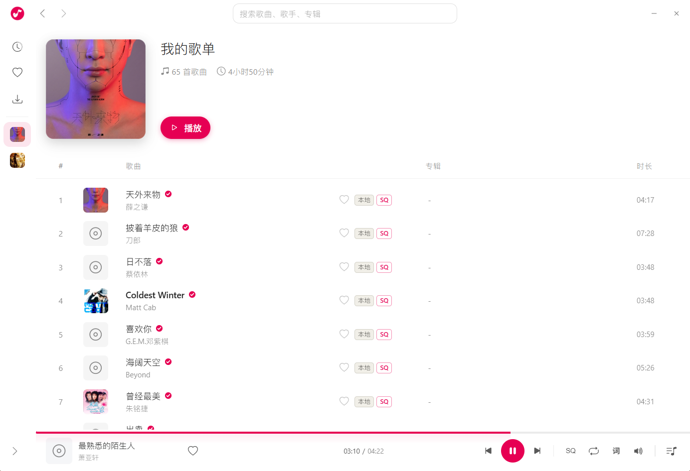
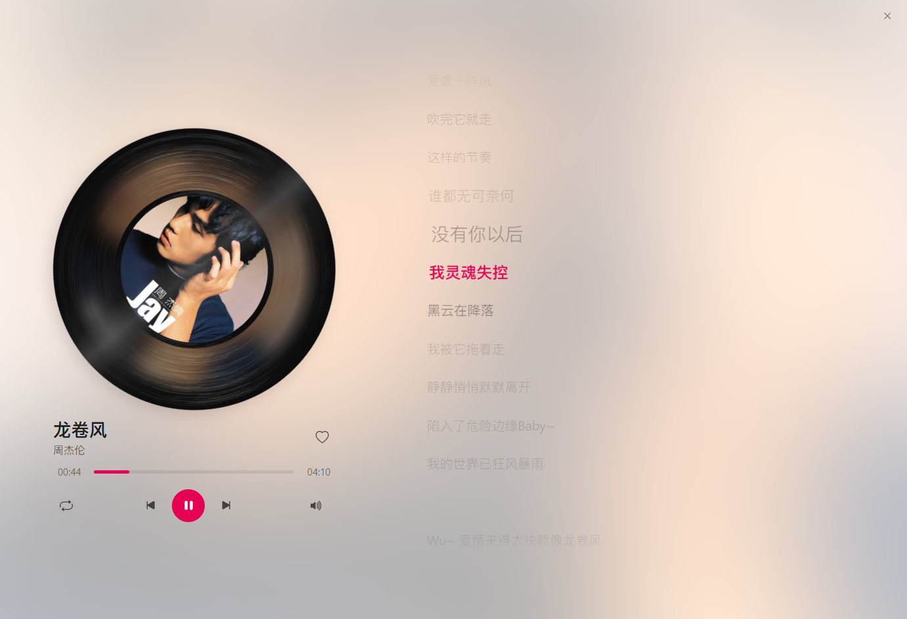
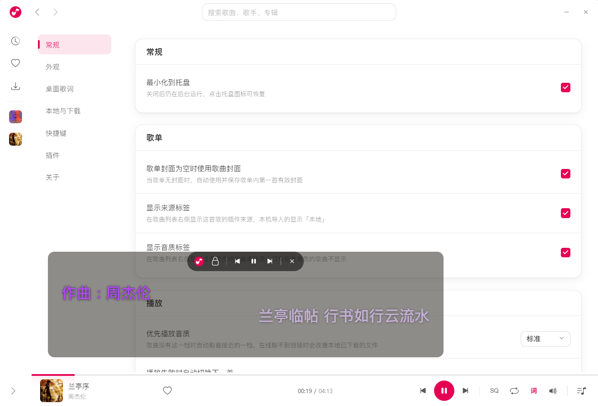

  

<h1 align="center">LightPlayer</h1>

  
  

一个支持插件扩展的本地音乐播放器

## 说明

已支持的平台：

- Windows 10 / 11（x64）

软件变化请查看[更新日志](https://github.com/jzhcl/light-player/blob/main/CHANGELOG.md)。

软件下载请查看 [GitHub Releases](https://github.com/jzhcl/light-player/releases)。

> [!NOTE]
> 首次安装时 Windows SmartScreen 会提示「未知发布者」，
> 点「更多信息」→「仍要运行」即可。

## 应用界面

## 数据存储目录

默认情况下，软件的数据存储在：

- Windows：`%APPDATA%/light-player`

## 项目协议

本项目基于 [Apache License 2.0](https://github.com/jzhcl/light-player/blob/main/LICENSE) 许可证发行。
